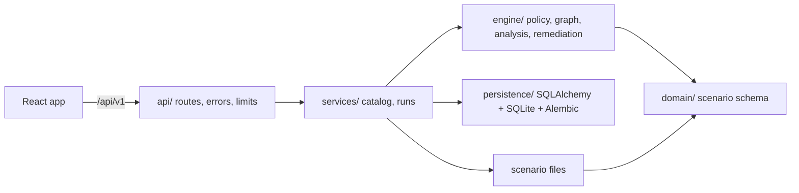

# SPECTRE

**Understand the path. Break the chain.**

SPECTRE is a cloud attack-path analysis and remediation-simulation tool. It loads a **synthetic** AWS-like environment, applies a small, documented subset of IAM authorization with a deterministic engine, and shows how identities, roles, policies and credentials chain together into access to sensitive assets. Every step of every finding is traced to the exact policy statement, trust entry or modeled relationship that justifies it. A remediation lab then lets you change permissions on a copy of the environment and see what actually happens: which paths disappear, which remain, and whether anything that must keep working broke.

> **Scope.** SPECTRE is an analysis and simulation tool for synthetic scenarios. It does not scan, exploit or modify real cloud infrastructure, it does not claim full AWS IAM compatibility, and no LLM takes part in any decision. A path it reports is reachable *under the modeled rules*; that is not proof of real-world exploitability. It has no authentication and is meant to run locally. It is a portfolio-grade MVP, not a production system.

## Contents

- [What it does](#what-it-does)
- [Quick start](#quick-start)
- [A five-minute walkthrough](#a-five-minute-walkthrough)
- [How it works](#how-it-works)
- [Scenario format](#scenario-format)
- [API](#api)
- [Architecture](#architecture)
- [Security notes](#security-notes)
- [Development](#development)
- [Roadmap](#roadmap)
- [License](#license)

## What it does

- **Scenario validation.** Strict, versioned JSON schema. Unknown fields, typo'd wildcards, dangling references and unsupported constructs (for example IAM `Condition` blocks) are rejected loudly instead of being silently treated as allowed.
- **Policy evaluation.** Allow, explicit Deny, wildcards, role trust and modeled credential access, producing `ALLOW`, `DENY`, `NOT_ALLOWED` or `UNSUPPORTED` decisions with evidence.
- **Transition graph.** Typed edges (declared, allowed, prerequisite, rejected), so you can see not only what is reachable but why a route is blocked.
- **Path discovery.** Bounded search from every identity to every sensitive resource. Hitting a limit is reported, never hidden.
- **Remediation simulation.** Remove or narrow a statement, drop a trust entry, detach a policy. The engine re-evaluates a copy and compares: resolved, remaining and new findings, legitimate access preserved or broken, residual risk.
- **History.** Every analysis and simulation is stored in SQLite and can be reopened.

| Stack | |
| --- | --- |
| Backend | Python 3.12+, FastAPI, Pydantic v2, SQLAlchemy 2, Alembic, SQLite |
| Frontend | React 19, TypeScript (strict), Vite, Tailwind CSS 4, React Router, TanStack Query, React Flow, Zod |
| Tooling | uv, pytest, ruff, mypy (strict), Vitest, Testing Library, Playwright, ESLint, Prettier, GitHub Actions |

## Quick start

Requirements: Python 3.12+, [uv](https://docs.astral.sh/uv/), Node.js 24 with npm, and GNU make.

```sh
make setup   # installs backend (uv) and frontend (npm) dependencies
make dev     # API on :8000, web app on :5173, both hot-reloading
```

Open <http://localhost:5173>. Interactive API docs are at <http://localhost:8000/api/docs>.

`make` adds `~/.local/bin` to `PATH`, so a per-user install of uv or Node is found even if your shell does not export it. Ports are fixed on purpose: Vite fails instead of silently switching, so the proxy and CORS settings always line up.

## A five-minute walkthrough

Three synthetic scenarios ship in `scenarios/`:

| Scenario | What the engine finds |
| --- | --- |
| **Northstar Financial** | A developer reaches the customer database through two role assumptions, a secret read, and a modeled credential-access relationship (4 steps, critical). |
| **Harbor Commerce** | A service identity with `s3:*` on `*` reaches a restricted export bucket directly (1 step, critical). |
| **Helios Platform** | Nothing. One route is blocked because the target role does not trust the caller; another is blocked by an explicit Deny. The graph shows both as rejected edges with the reason. |

Try it:

1. Pick **Northstar Financial** in the top bar and click **Run analysis**.
2. **Findings**: a critical path with four steps. Expand *Evidence* on any step to see the policy statement or trust entry behind it, resolved from the scenario.
3. **Attack graph**: select a finding to highlight its path. Click any edge to see the decision, the reason and the evidence. Use the checkboxes to show rejected or declared edges.
4. **Remediation lab**: remove statement `assume-runtime` from *CI deployer permissions* and run the simulation. Verdict: *Effective under the modeled rules*; both findings resolved, legitimate access intact.
5. Reset, then remove `assume-ci` from *Developer may assume the CI deployer* instead. The path also disappears, but the verdict is **Breaks legitimate access**. Removing a path is not a fix if it breaks what must keep working.

## How it works

### Authorization subset

SPECTRE evaluates `(identity, action, resource)` against the policies attached to the identity. It is deliberately small.

| Decision | Meaning |
| --- | --- |
| `DENY` | An applicable `Deny` statement matched. It always wins. |
| `ALLOW` | No Deny matched and an Allow did (plus role trust, for role assumption). |
| `NOT_ALLOWED` | Nothing granted it. This is the default. |
| `UNSUPPORTED` | The question is outside the subset (unknown identity or resource, `sts:AssumeRole` aimed at a non-role). Never treated as allowed. |

- **Matching** is case-sensitive. `*` matches everything, a trailing `*` is a prefix match, anything else is exact. Resources are scenario entity ids, `*`, or an id prefix ending in `*`.
- **Role assumption** needs both an Allow for the caller **and** the caller listed in the role's `trusted_identities`. Either alone is `NOT_ALLOWED`.
- **Credential access** is modeled explicitly: a `credential_access` relationship goes from a *secret* to another entity, and is usable only by an identity that is allowed `secretsmanager:GetSecretValue` on that secret.
- **Reachability probes.** To ask "can this identity reach this resource at all?", the graph builder evaluates each action pattern named by the identity's Allow statements. A probe is covered by a Deny only if the Deny covers the whole pattern. So Allow `s3:*` on `*` with Deny `s3:*` on `pii-lake` blocks `pii-lake`, while a Deny on just `s3:GetObject` leaves the rest of `s3:*` reachable. Actions are matched by pattern only, not against resource type.
- **Evidence.** Each decision lists the `(policy id, statement sid)` of every matching statement and the `(role, identity)` trust entry where relevant. Statements carry stable `sid`s, so evidence never depends on array position.

**Not modeled** (scenarios using them are rejected or the feature is absent): conditions, service control policies, permission boundaries, session policies, resource-based policies other than role trust, service-specific behavior, real credential validity, network controls, and real exploit preconditions.

### Graph and paths

| Edge | Meaning | In a path? |
| --- | --- | --- |
| `inventory` | A role's trust policy lists an identity. | No |
| `authorized` | Backed by an `ALLOW` (role assumption, resource access, secret read). | Yes |
| `prerequisite` | A scenario-modeled transition, traversable only from a secret reached by an authorized read. | Yes |
| `rejected` | Evaluated and denied or only partially granted. Kept to explain *why not*. | No |

A drawn edge is never a finding by itself. A finding exists only when a chain of `authorized`/`prerequisite` edges reaches a sensitive resource, and every step carries evidence.

- Entry points are users and services (and the principal of any security objective). Roles are never entry points. Targets are `restricted` or `confidential` resources, plus any objective target.
- **Severity** comes from the target's declared sensitivity only: restricted is critical, confidential is high (internal/medium and public/low appear only when an objective names the target). There is no other score, and shortest path length is never used as a risk measure.
- **Limits.** Depth 8, 20 paths per source/target pair, 20,000 edge expansions. A path never revisits a node, so cycles cannot loop. Reaching a limit sets a `truncated` flag that the UI shows, because a search that was cut short cannot certify absence.
- **Objectives** (`must_be_unreachable`) are *violated* if a finding exists, otherwise *hold* (with a note if the search was limited). **Legitimate access** checks use the same evaluator and must keep passing after any change.

### Remediation simulation

A change set (1 to 25 changes) is applied to a deep copy that is re-validated against the full schema; the original is never modified.

| Change | Effect |
| --- | --- |
| `remove_statement` | Drops one policy statement (a policy left empty is removed). |
| `replace_statement` | Rewrites effect, actions and resources of one statement. |
| `remove_trust` | Removes an identity from a role's trust entries. |
| `detach_policy` | Detaches a policy from one identity. |

The verdict is deliberately strict and only `effective` counts as success:

| Verdict | Meaning |
| --- | --- |
| `effective` | No findings remain, every objective holds, no legitimate access lost, search complete. |
| `partial` | Some paths removed, others remain (listed as residual risk). |
| `ineffective` | Nothing resolved. |
| `breaks_legitimate_access` | Takes precedence: something that passed before now fails. |
| `introduces_findings` | The change opened a new path. |
| `inconclusive` | Looks fixed, but a search limit was hit, so it cannot be certified. |
| `nothing_to_remediate` | The baseline had no findings. |

## Scenario format

Scenarios live in `scenarios/<id>/scenario.json` and are validated with Pydantic (`schema_version: "1"`). Ids match `^[a-z0-9][a-z0-9-]{0,63}$`. A minimal example:

```json
{
  "schema_version": "1",
  "metadata": { "id": "demo", "name": "Demo", "description": "...", "intended_outcome": "..." },
  "principals": [{ "id": "alice", "name": "Alice", "kind": "user" }],
  "roles": [{ "id": "role-a", "name": "Role A", "trusted_identities": ["alice"] }],
  "resources": [{ "id": "db", "name": "Main DB", "kind": "database", "sensitivity": "restricted" }],
  "policies": [{
    "id": "p1", "name": "Alice may assume Role A", "attached_to": ["alice"],
    "statements": [{ "sid": "assume", "effect": "Allow", "actions": ["sts:AssumeRole"], "resources": ["role-a"] }]
  }],
  "relationships": [],
  "legitimate_access": [],
  "objectives": [{ "id": "o1", "description": "Alice must not reach the DB",
                   "principal": "alice", "target": "db", "expectation": "must_be_unreachable" }]
}
```

Validation also enforces: unique ids; every reference resolves; a resource wildcard prefix must match at least one entity (so a typo cannot silently disable a Deny); a `credential_access` source must be a secret; `sts:AssumeRole` in legitimate access must target a role; statement `sid`s are unique within a policy.

## API

Base path `/api/v1`. OpenAPI at `/api/openapi.json`. Errors always have the shape `{"error": {"code", "message", "details"}}`.

| Endpoint | Description |
| --- | --- |
| `GET /health` | Status and version |
| `GET /capabilities` | Implemented features, supported and unsupported policy semantics, engine version |
| `GET /scenarios` | Scenario summaries plus any invalid files and why (invalid files are reported, not hidden) |
| `GET /scenarios/{id}` | The validated scenario document |
| `POST /analyses` | `{scenario_id}`: runs the engine, stores and returns the summary |
| `GET /analyses` | Stored runs, newest first (`scenario_id`, `limit`) |
| `GET /analyses/{id}` | Summary, objective results, legitimate-access checks, limits |
| `GET /analyses/{id}/graph` | Nodes and typed edges with decisions and evidence |
| `GET /analyses/{id}/findings` | Findings with paths whose every step carries evidence |
| `POST /simulations` | `{scenario_id, changes[]}`: applies to a copy, re-analyzes, compares |
| `GET /simulations`, `GET /simulations/{id}` | Stored simulations |

Request bodies are capped at 64 KiB, unknown fields are rejected, and ids/actions/resources use the same patterns as the scenario schema.

## Architecture

A modular monolith: one FastAPI process, one React single-page app, one SQLite file. No queues, caches or extra services.



```
apps/api/src/spectre/
  api/          HTTP routes, error handling, request-size limit
  schemas/      transport DTOs and the mappers that turn engine results into JSON
  services/     scenario catalog, run orchestration
  engine/       policy, graph, analysis, remediation (pure Python)
  domain/       the scenario model
  persistence/  SQLAlchemy models, engine, Alembic migrations (shipped in the package)
apps/web/src/
  app/ components/ features/{overview,graph,findings,remediation,scenarios,analysis-history,settings}/ lib/
scenarios/      the three synthetic scenarios
```

Design decisions that matter:

- **Dependency direction is `api -> services -> engine -> domain`.** The engine and domain import neither FastAPI nor SQLAlchemy, and the policy engine never queries a database. The engine returns frozen dataclasses; `schemas/` is the one explicit place they become JSON.
- **Deterministic by construction.** The same scenario and limits always produce an equal result, so a stored run is reproducible. Decisions, graph, paths and severity come only from deterministic code.
- **Evidence is structural.** A graph edge cannot be created without the decision that produced it, and a path step without evidence cannot exist.
- **The frontend is a renderer.** It computes nothing security-relevant; the only client-side logic is graph layout.
- **The API contract is generated.** `make openapi` exports the OpenAPI document and generates TypeScript types; the hand-written Zod schemas carry compile-time assertions against them, so a backend change that breaks the frontend fails `tsc`.
- **SQLite and migrations.** Two tables (`analysis_runs`, `simulation_runs`) hold each run's result as JSON. Migrations run at API startup. The database URL is configuration, so moving to PostgreSQL later is a configuration and review task.

## Security notes

Scenario JSON is treated as **untrusted input**.

- Strict schema with unknown fields rejected; ids restricted to a safe pattern; the file read is bounded (default 1 MB) and any per-file failure, including pathological nesting, is reported without affecting other scenarios.
- Scenario ids are only ever compared to a directory listing, never joined into a path; symlinked directories and files are skipped and containment is checked.
- Nothing in a scenario is executed: no `eval`, no shell, no unsafe deserialization. The frontend never renders user-provided HTML.
- Request bodies are limited, simulations are typed and bounded, and error messages are capped and generic for I/O failures (details go to the server log).
- CORS is limited to the local dev origins and to `GET`/`POST`.
- The containers run as non-root with read-only filesystems and dropped capabilities, and the API port is not published. nginx sets a Content-Security-Policy for the app. **The Docker setup is configured but has not been run or verified.**

Residual risks: no authentication (do not expose it to untrusted networks); findings are only as accurate as the modeled subset; dependencies are not yet audited automatically.

## Development

```sh
make dev        # run API and web with hot reload      (make dev-api / make dev-web separately)
make test       # backend + frontend tests
make lint       # ruff, ESLint, Prettier checks
make typecheck  # mypy (strict), tsc (strict)
make build      # production web build
make check      # lint + typecheck + test + build (what CI runs)
make e2e        # Playwright; first: cd apps/web && npx playwright install chromium
make openapi    # regenerate OpenAPI spec + TypeScript types after an API change
make migrate    # apply migrations by hand (the API also does this on startup)
make docker-up  # build and run both containers (see Security notes)
make format     # auto-format both apps
```

**Configuration** (environment variables, or `apps/api/.env`; see `.env.example`): `SPECTRE_SCENARIOS_DIR`, `SPECTRE_DATABASE_URL` (default `sqlite:///./data/spectre.db`), `SPECTRE_CORS_ORIGINS`, `SPECTRE_MAX_SCENARIO_BYTES`. The Vite dev proxy target is `SPECTRE_API_URL` (default `http://localhost:8000`). The browser always calls a relative `/api/v1`, so no API URL is baked into the build.

**Tests.**

| Layer | What it covers |
| --- | --- |
| Engine unit (pytest) | Matching, evaluator decisions and evidence, graph edge types, search limits and truncation, objectives, remediation verdicts, and the three scenarios as golden outcomes. No HTTP, no database. |
| Backend (pytest) | Scenario schema, catalog hardening, every endpoint against a real migrated SQLite file, structured errors, request limits, CORS, migration up/down and model-versus-migration agreement. |
| Frontend (Vitest) | Every page's loading, error, empty and success states; remediation staging and verdicts; scenario state and persistence; graph layout; contract violations. |
| E2E (Playwright) | Real browser against the real API: run an analysis, read evidenced findings, simulate fixes. |

Backend tests never read your `SPECTRE_*` variables or a local `.env`.

**Adding to the subset.** Change the evaluator, update the capabilities list in `services/capabilities.py` and the README, extend the schema (and bump `schema_version` if the document format changes), and add tests for `ALLOW`, `DENY`, `NOT_ALLOWED` and `UNSUPPORTED`.

**Troubleshooting.** `uv` or `node` not found outside `make`: add `~/.local/bin` to `PATH`. Port 5173 busy: free it rather than letting Vite pick another. The top bar shows "API: unreachable": start the API or check `SPECTRE_API_URL`.

## Roadmap

- Run and verify the Docker build; add a smoke request to CI.
- More fixtures: wide fan-out, partial denies, a scenario that hits the search limits.
- Resource-type-aware actions (`s3:*` should not apply to a database).
- Compare two analyses side by side in History.
- Export a finding's evidence as a Markdown report.
- Dependency auditing in CI.
- Conditions as an explicitly scoped, tested extension of the subset.

## License

MIT. See [LICENSE](LICENSE).
